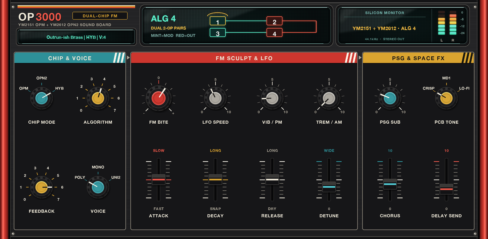

# OP3000 — Dual-Chip FM Arcade Synthesizer for Akai MPC

[](https://thediskking.com/plugins/op3000/)



**OP3000** (`UID: OPAR`, vendor `Stampman3000`) is a standalone dual-chip 4-operator FM arcade synthesizer for Akai MPC OS 3.10.1+ (32-bit ARM32 Cortex-A17 & 64-bit ARM64), pairing **Yamaha YM2151 (OPM)** and **Yamaha YM2612 (OPN2)** style FM synthesis cores with an **SN76489-style PSG sub-chip**, per-voice hybrid analog filter, Mega Drive Model 1 warm filter stage, 1980s stereo BBD chorus, and tempo-synced ping-pong stereo delay.

Licensed under the **MIT License** — see [LICENSE](LICENSE) and [NOTICE.md](NOTICE.md).

## Highlights
- **Dual-Chip Yamaha FM Core (`dsp/YamahaSiliconFm.h`)**:
  - Uses Yamaha's exact 256-entry `logsinrom` and `exprom` lookup tables, 10-bit exponential envelope generator (`AR / D1R / D2R / SL / RR` + `SSG-EG` Loop/Alt/Inv), `(fb0 + fb1) >> (9 - fb)` feedback, all 8 FM algorithms (`0..7`), YM2151 `DT2` inharmonic coarse ratios + 17-bit LFSR noise, and YM2612 9-bit ladder DAC crossover grit.
  - **Three Hardware Modes**: `OPM 2151` (8 voices), `OPN2 2612` (6 voices), and **`HYBRID`** (dual-chip stacked 6 voices with `Chip Blend`, `OPN2 Oct`, and `OPN2 Detune`).
- **SN76489 PSG Sub-Chip + PCB Tone + 80s FX (`dsp/OpArcadeEngine.h`)**:
  - Selectable `Square / Sub -1 / Sub -2 / Pulse / LFSR Noise` sub-oscillator with dedicated decay envelope.
  - `PCB Tone` (`Crisp / MD1 Warm 3.4 kHz LP / Lo-Fi Grit`), 80s dual-BBD stereo chorus, and tempo-synced stereo ping-pong delay (`1/16 .. 1/2`).
- **Per-Voice Hybrid Analog Filter (`dsp/OpArcadeEngine.h` — Tab 4 `FILTER`)**:
  - Zero-delay-feedback TPT State-Variable Filter (`LP12 / LP24 / BP12 / HP12`) with warm OTA saturation in the resonance loop + pre-filter 12 dB/oct Butterworth **HPF Cutoff** (`20 Hz – 4.5 kHz`) + **OTA Drive**.
  - Dedicated per-voice **ADSR Filter Envelope** (`+/-5` octaves), Velocity sensitivity, Keytracking around C4, and LFO -> Cutoff modulation. Bypassed cleanly when wide open (`LP24 / 19 kHz / HPF Off`) so existing presets stay identical and dry FM paths run zero filter overhead.
- **32 Factory Arcade & Mega Drive Presets (`bridge/OpArcadePresets.h`)**:
  - *Outrun-ish Brass*, *Lately FM Bass*, *Streets Slap*, *CPS-1 Lead*, *Crystal Rhodes*, *Sonic DT2 Bell*, *Cyber Hybrid Stack*, *X68000 Strings*, *MD1 Choir Pad*, *SSG-EG Sci-Fi*, *FM Kick*, *Arcade Noise Perc*, and more.
- **1986 Arcade Cabinet & Curved-Glass VFD/CRT UI (`tools/gen_ui_assets.py`)**:
  - 4 bottom tab keys (`OP3000`, `OP 1-2 / OP 3-4`, `HYBRID / MOD/AM`, `FILTER`) with 100% hardware Q-Link coverage across all 81 automatable parameters, glossy 1986 Arcade-Red T-molding rails, curved-glass VFD/CRT 8-algorithm & filter Bode schematics, stereo peak meters, coloured-cap fluted hardware knobs, and calibrated vertical faders.

## Real On-Device MPC One (Cortex-A17, 44.1 kHz / 128-frame) CPU Benchmarks
| Scenario | Avg (µs) | p99 (µs) | Avg % CPU |
| :--- | ---: | ---: | ---: |
| YM2612 OPN2 Only (6 voices, dry) | 185.7 µs | 425.2 µs | **6.40%** |
| YM2151 OPM + Chorus + Delay | 196.0 µs | 568.4 µs | **6.75%** |
| YM2612 OPN2 + Chorus + Delay | 198.0 µs | 404.2 µs | **6.82%** |
| HYBRID Dual-Chip (dry, 12 FM voices) | 357.9 µs | 732.0 µs | **12.33%** |
| HYBRID Dual-Chip + PSG + FX | 402.0 µs | 996.0 µs | **13.85%** |
| HYBRID + PSG + Per-Voice VCF (LP24 + HPF + Env) + FX | 477.9 µs | 859.8 µs | **16.47%** |

*(17.9× faster than gate-level Nuked-OPM on Gen1 MPC One while preserving Yamaha's exact ROM tables, EG, algorithms, feedback shift, `DT2`, `SSG-EG`, and 9-bit ladder DAC.)*

## Build & Verify
```bash
bash tools/build_all.sh
bash tools/run_tests.sh
```
Deployable archive: `dist/op3000-1.0.1-mpc.zip` (extract `"Stampman3000 - VST - OP3000"` into `VST2 Plugins/` on your MPC drive).

☕ If this saves you time, you can [buy me a coffee](https://paypal.me/johnnybarter1).
